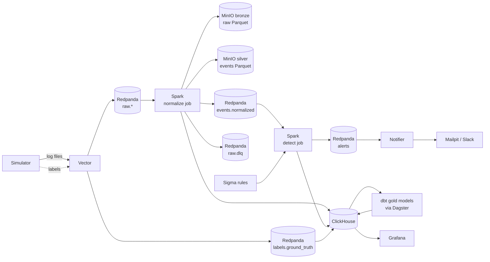

# SentinelFlow

SentinelFlow is a small security information and event management pipeline. It collects web
server, SSH, firewall and application authentication logs, normalizes them into one schema,
evaluates Sigma detection rules on the stream, maps alerts to MITRE ATT&CK, enriches them with
GeoIP and threat intelligence, and stores everything in a bronze, silver and gold data layout.

Detection rules are hard to evaluate without labelled data. SentinelFlow ships an attack
simulator that writes realistic logs together with ground truth labels, so every rule can be
measured for precision, recall and detection latency, and changes to a rule can be compared
on the same data.

## Architecture



## Data flow and layers

| Layer | Where | Contents |
|---|---|---|
| Raw | `raw.nginx`, `raw.ssh`, `raw.firewall`, `raw.app` | log lines as written, one topic per source |
| Bronze | `s3://bronze/raw_logs` | raw lines with Kafka coordinates, partitioned by source and ingest date |
| Silver | `s3://silver/events`, `events.normalized`, ClickHouse `events` | normalized events, partitioned by source and event date |
| Dead letters | `raw.dlq`, ClickHouse `parse_failures` | lines that failed to parse, with the reason |
| Alerts | ClickHouse `alerts`, `alerts` topic | versioned alerts with enrichment and risk score |
| Gold | ClickHouse `analytics.*` | dbt marts: daily summary, attacker addresses, user risk, detection efficacy, MITRE coverage |

The normalized schema is defined once in `streaming/schema.py`. A test checks that the ClickHouse
DDL, the dbt source, the PySpark schema and the Python dataclass all match it.

## Detection coverage

Measured on the validation dataset (48 hours, 200 users, 21 attacks at three intensities) with the
current rules. See [docs/detection-tuning.md](docs/detection-tuning.md) for the method and the
other datasets.

| Rule | MITRE ATT&CK | Type | Precision | Recall | Mean latency |
|---|---|---|---|---|---|
| SSH brute force | T1110.001 | correlation (event count) | 1.00 | 1.00 | 14 s |
| Password spraying | T1110.003 | correlation (value count) | 1.00 | 1.00 | 101 s |
| Credential stuffing | T1110.004 | correlation (value count) | 1.00 | 1.00 | 73 s |
| Brute force followed by success | T1110.001, T1078 | correlation (temporal ordered) | 1.00 | 1.00 | 62 s |
| Port scan | T1046 | correlation (value count) | 1.00 | 1.00 | 0.3 s |
| Web attack pattern | T1190 | single event | 1.00 | 1.00 | 30 s |
| Known scanner user agent | T1595.002 | single event | 1.00 | 1.00 | 0 s |
| Impossible travel | T1078 | Python detector | 1.00 | 1.00 | 2730 s |

These numbers describe simulated traffic that the rules were designed for. They show that the
rules work end to end and how they react to low and slow variants, not how they would score on
production logs.

## Tuning in short

The first rule set scored perfectly on an easy dataset. A harder dataset with low intensity
attacks showed two problems: password spraying missed half the attacks because they spread
across addresses and stayed just under ten accounts per address, and impossible travel flagged a
user switching from a home line to a mobile line in the same country.

Lowering the spraying threshold to five fixed recall but multiplied alerts from 14 to 152,
because every credential stuffing proxy now matched as well. Precision stayed at 1.0, so only
the alert breakdown revealed the problem. A guard on client consistency (at most two user agents
per address) brought the count back to 27 without losing an attack. A holdout dataset then
exposed impossible travel false positives inside the United States, which led to ignoring moves
within one network operator. Checking that change on a fresh dataset first showed no effect at
all, which uncovered a bug in how boolean rule parameters were parsed.

Details and all tables: [docs/detection-tuning.md](docs/detection-tuning.md).

## Design decisions

| Record | Decision |
|---|---|
| [ADR 0001](docs/adr/0001-record-architecture-decisions.md) | Record decisions as ADRs |
| [ADR 0002](docs/adr/0002-single-package-with-extras.md) | One Python package with optional dependency groups |
| [ADR 0003](docs/adr/0003-ground-truth-labels.md) | Ground truth labels outside the log lines, joined by line hash |
| [ADR 0004](docs/adr/0004-native-spark-parsing.md) | Native Spark parsing built from one format spec |
| [ADR 0005](docs/adr/0005-delivery-semantics.md) | Delivery semantics per sink |
| [ADR 0006](docs/adr/0006-clickhouse-event-table.md) | ReplacingMergeTree events table with insert deduplication |
| [ADR 0007](docs/adr/0007-windowing-and-late-data.md) | Event time sliding windows, watermark and update mode |
| [ADR 0008](docs/adr/0008-alert-evaluation-on-the-driver.md) | Threshold evaluation and suppression on the Spark driver |

Further reading: [detection engine](docs/detection-engine.md), [risk scoring](docs/risk-scoring.md).

## Getting started

Requirements: Docker with Compose v2 and about 8 GB of memory for Docker, GNU Make, and
[uv](https://docs.astral.sh/uv/) for local development.

```sh
cp .env.example .env
make demo
```

`make demo` builds the images, starts all services and waits until they are healthy, backfills
six hours of traffic with every attack scenario, streams three minutes of live traffic with a
few attacks, then waits for the pipeline to drain, builds the dbt models and prints event counts,
alert counts and per rule precision and recall.

| Service | URL |
|---|---|
| Grafana | http://localhost:3000 |
| Mailpit | http://localhost:8025 |
| Dagster | http://localhost:3001 |
| Redpanda Console | http://localhost:8080 |
| MinIO Console | http://localhost:9001 |
| Spark Master | http://localhost:8090 |
| ClickHouse HTTP | http://localhost:8123 |

Other useful targets:

```sh
make up PROFILES="core streaming"   # start a subset of services
make attack SCENARIO=port_scan      # replay one attack into the last 15 minutes
make summary                        # rebuild dbt models and print efficacy
make redetect                       # reprocess all events with the current rules
make logs SERVICE=spark-detect
make clean                          # stop everything and remove volumes
```

GeoIP and threat intelligence work offline by default with fixture data that covers the
simulator address ranges. `sentinelflow-enrich geoip --source dbip` downloads DB-IP Lite,
`THREAT_INTEL_FEEDS=fixture,firehol` adds the FireHOL level 1 list, and `ABUSEIPDB_API_KEY`
enables AbuseIPDB lookups for alert addresses.

## Dashboards

| Dashboard | Contents |
|---|---|
| SOC Overview | alerts by level, alerts and events over time, top rules, attacker map, riskiest addresses and users |
| Alert Detail | filterable alert list, selected alert with enrichment, related events |
| Detection Engineering | precision, recall and latency per rule, MITRE coverage, alerts per rule |
| Pipeline Health | ingest freshness, consumer lag, rows per second, micro batch duration, dead letters |

High and critical alerts are sent by the notifier to Mailpit and, if `SLACK_WEBHOOK_URL` is set,
to Slack. Each message states what happened, the entity, the MITRE techniques, the risk score,
location and threat intel, and links to the alert in Grafana.

## Adding a rule

1. Write the rule in `detections/rules/<name>.yml` using the normalized field names. Building
   blocks and the correlation that uses them can share a file. The supported Sigma subset is
   described in [docs/detection-engine.md](docs/detection-engine.md).
2. Add `detections/fixtures/<name>.yml` with at least one case that must alert and one that
   must not.
3. If a simulator scenario exercises the rule, map them in `transform/seeds/rule_scenario_map.csv`.
4. Run `make rules`. It validates all rules, runs every fixture and refreshes the rule catalogue
   used by dbt.
5. Run `make redetect` and `make summary` to measure the rule on the data already in the stack.

The detect job mounts `detections/rules`, so restarting `spark-detect` is enough to load changed
rules. New Python detectors need an image rebuild.

## Development

```sh
make install      # uv sync --all-extras
make lint         # ruff and mypy
make test         # unit tests, Spark tests run where Java is available
make test-spark   # all tests inside the Spark image, including file sink tests
make test-e2e     # end to end test against a running stack
```

On Windows, Spark tests that write files need `HADOOP_HOME`; they are skipped otherwise and run
in CI and in `make test-spark`.

CI runs linting, unit tests with Spark, rule validation, dbt build against a ClickHouse service
container and image builds. The end to end workflow is started manually.

## Project layout

```
simulator/            log and attack generator with ground truth labels
ingestion/vector/     Vector configuration
streaming/            schema, parsers and the Spark normalize and detect jobs
detections/rules/     Sigma rules
detections/fixtures/  positive and negative cases per rule
detections/engine/    rule loader, compiler, correlation, detectors, suppression
enrichment/           GeoIP, threat intelligence, alert enrichment, risk scoring
notifier/             alert notifications by email and Slack
orchestration/        Dagster definitions, lake maintenance, demo summary
transform/            dbt project
storage/clickhouse/   migrations and client helpers
dashboards/grafana/   provisioning and dashboards
tests/                unit, Spark and end to end tests
docs/                 ADRs and design notes
```

## Known limitations

- Traffic is simulated. Real logs contain formats, noise and attacks the simulator does not
  produce, and the efficacy numbers do not transfer to them.
- Threshold evaluation, detectors and suppression run on the Spark driver. This keeps one
  implementation for tests and streaming, but limits throughput to what one process can handle.
- Kafka topics are at least once. Every consumer in the project deduplicates, external consumers
  would have to do the same.
- Checkpoints are stored in MinIO through S3A, which has no atomic rename.
- There is no alert workflow: alerts cannot be acknowledged or closed from the dashboards.
- Only IPv4 is supported.

## Possible next steps

- Move suppression and detectors into `transformWithStateInPandas` to scale beyond one driver.
- Replay real public datasets through the parsers to test them against real formats.
- Add an alert triage workflow with status changes written back to ClickHouse.
- Calibrate risk weights against analyst verdicts.
